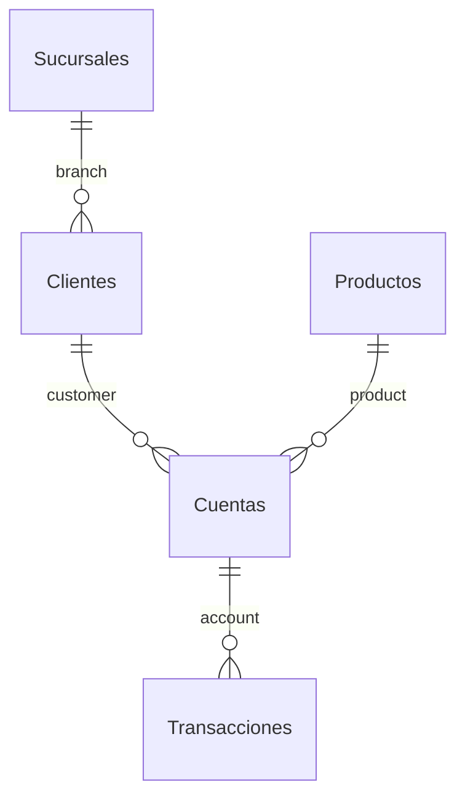

# Banking Sales Analytics

A SQL Server portfolio project focused on banking transaction activity, customer segmentation, account analysis and data quality. It uses a synthetic retail banking dataset to demonstrate relational modeling, analytical SQL, reconciliation and reproducible reporting.

## Objectives

- Analyze transaction volume, amounts and approval/rejection rates.
- Compare monthly activity in 2025 and 2026 using equivalent periods.
- Identify high-activity customers and rank customers by recorded transaction amounts within each segment.
- Validate data integrity, transfer pairing and account activity.

## Technology

- Microsoft SQL Server 2025 Developer Edition (17.x)
- SQL Server Management Studio (SSMS)
- Transact-SQL (T-SQL): joins, CTEs, conditional aggregation, window functions, `ROW_NUMBER`, `COUNT(DISTINCT)`, null handling and reconciliation queries.

## Dataset

All records are synthetic; this project contains no real bank or customer data and is not an employer project. Table and column names are in Spanish. The transaction date range is January 1, 2025 to November 17, 2026.

| Table | Description | Records |
|---|---|---:|
| `Sucursales` | Branches | 5 |
| `Clientes` | Customers and segments | 1,000 |
| `Productos` | Banking products | 3 |
| `Cuentas` | Accounts and snapshot balances | 1,649 |
| `Transacciones` | Transaction records | 29,668 |
| **Total** | | **32,325** |

## Data model



The diagram shows the logical one-to-many relationships in the dataset. The schema allows nullable branch and product foreign keys; the foreign keys enforce valid references when populated.

## Repository structure

```text
banking-sales-analytics/
├── README.md
├── sql/
│   ├── 01_database_schema.sql
│   ├── 02_sample_data.sql
│   ├── 03_data_quality.sql
│   ├── 04_transaction_analysis.sql
│   ├── 05_rejection_analysis.sql
│   ├── 06_temporal_analysis.sql
│   ├── 07_customer_analysis.sql
│   └── 08_account_analysis.sql
└── docs/
    └── project_findings.md
```

## Reproduce the project

1. Download or clone the repository and connect to a SQL Server 2025 instance using SSMS with permission to create a database.
2. Ensure the target database `BankingSalesAnalytics` does not exist, or use a separate, empty database and consistently update every database-name reference in local copies of the scripts. Do not run the setup scripts against a populated database.
3. Run `sql/01_database_schema.sql` to create the database and five tables, primary and foreign keys, and the default transaction status.
4. Run `sql/02_sample_data.sql` once to load the exported synthetic records while preserving their original identifiers. This file is a data snapshot, not a random data-generation algorithm.
5. Run `sql/03_data_quality.sql` to check record counts, critical nulls, potential duplicates, orphan references, transfer exceptions and customer reconciliation.
6. Run scripts `04` through `08` for the analytical results.

The setup scripts are not designed for repeated execution against populated tables. If a load fails, investigate the error and verify the target database before retrying. Use SSMS to execute the scripts, which contain `GO` batch separators.

## Key results

| Metric | Result |
|---|---:|
| Transaction records | 29,668 |
| Approved records | 28,094 |
| Rejected records | 1,574 |
| Record-based rejection rate | 5.31% |
| Total recorded transaction amount | 229,328,735.00 |
| Customers with recorded activity | 951 (95.1%) |
| Active accounts | 1,485 |
| Active accounts without transaction records | 0 |

Amounts are expressed in dataset monetary units. Total recorded amounts include rejected requests and both legs of approved transfers; they do not represent bank revenue, net cash flow or unique business transaction volume. Account balances are snapshot values, not a ledger reconstructed from the exported transactions.

The six read-only analysis scripts were executed on the original database. On November 25, 2026, the schema and data snapshot were loaded into a separate test database and the principal data-quality and reconciliation indicators matched. A full row-by-row comparison was not performed.

For detailed results, metric definitions and known exceptions, see [Project findings](docs/project_findings.md).

## Next steps

Extend the same dataset into a Power BI reporting project and later explore Python-based analysis. These extensions are planned and are not included in the current SQL release.
